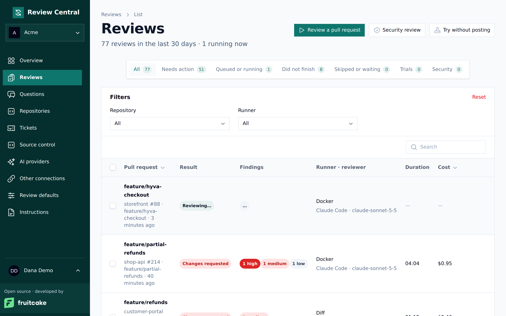

<p align="center"></p>

<h1 align="center">Review Central</h1>

<p align="center">
AI code review for <strong>private Bitbucket repositories</strong>, on your own server:<br>
faster and cheaper than an AI step in Bitbucket Pipelines, with the ticket as context, and it acts on the pull request.
</p>

<p align="center">
<a href="https://review-central.com"><strong>Documentation</strong></a> ·
<a href="https://review-central.com/guide/quick-start">Quick start</a> ·
<a href="https://review-central.com/guide/installation">Installation</a>
</p>


## Why it exists

On GitHub, AI review is a few clicks away: Copilot and a marketplace of review apps. Bitbucket Cloud has far less to choose from, and the usual answer is an AI CLI in a pipeline step. We ran it that way, and it showed:

- **Every push starts from nothing.** A fresh clone, a fresh `composer install`, and a reviewer that has forgotten the last review, all on build minutes.
- **It only knows the diff.** Not the ticket it was for, not what people replied to the last review, not what was already decided.
- **It can only comment.** No tasks, no approval, no request for changes, and nobody resolves the threads of what was fixed.

Review Central takes the review out of the pipeline. It runs next to Bitbucket, takes its webhook, and reviews each pull request in a sandbox of its own:

| | An AI step in Bitbucket Pipelines | Review Central |
|---|---|---|
| **Each push** | Clones and installs from scratch, on build minutes | Reuses the installed `vendor/` and the Composer cache; skips drafts, commits it reviewed and pushes with nothing new |
| **The reviewer** | Starts over every time | Claude Code resumes its last session on the branch; a commit pushed during a review can be reviewed in the same job |
| **Context** | The diff | The ticket from Jira, Asana or GitHub Issues, the conversation and earlier findings, the repository's own rules, a guide for its stack |
| **On the pull request** | A comment | A summary in the description, a comment per finding with a fix to apply, tasks for what blocks the merge, an approval or a request for changes, threads resolved when fixed, a Code Insights report |
| **Talking back** | — | `/review` to review again, `@review` to ask a question, replies the next review reads |
| **Cost** | Build minutes plus tokens, per repository | What each run cost, per team and per reviewer, against a budget |

It started as exactly such a pipeline step at [Fruitcake](https://fruitcake.nl), on the private Bitbucket repositories we work in. GitHub works too: reviews are posted on its pull requests as well.

## What it does

- **Reviews against the ticket.** The reviewer reads the pull request with its ticket from Jira, Asana or GitHub Issues, so it checks what was asked for, not only what was written.
- **Acts on the pull request.** A summary in the description, a comment per finding, tasks for what blocks the merge, and an approval or a request for changes. The next push marks what was fixed and resolves its threads. On **Bitbucket Cloud** and **GitHub**, which has no tasks.
- **Your reviewer, your model.** Claude Code, Codex, OpenCodeReview or Pi, with the model and effort you set, or only the diff sent to your AI provider: Anthropic, OpenAI, Gemini, Mistral, Groq, DeepSeek, xAI or OpenRouter.
- **Sandboxed.** The reviewer reads the code in a throwaway container under gVisor, or in a Cloudflare sandbox (experimental), holding nothing but the AI key. Your code stays on your server and your sandbox, and goes to the AI provider you chose.
- **Many teams, one installation.** Each tenant brings its own connections, colours, currency and time zone; the admin panel shows every tenant's cost against its budget.
- **Measured.** Findings are marked valid, not a problem or wrong, and the overview shows how often the team agrees with the reviewer.

| | |
|---|---|
|  |  |
|  |  |

## Try it in ten minutes

Review a public GitHub pull request from its diff, on your own machine. Nothing is cloned and no code is run. You need PHP 8.4+, Composer and an AI provider's key, such as Anthropic's or OpenAI's.

```sh
git clone https://github.com/fruitcake/review-central.git && cd review-central
composer setup               # .env, an app key, SQLite and the tables
php artisan review:install   # the review's instructions, model prices, your admin account and a first tenant
php artisan serve
```

In a second terminal, run the queue the reviews run on:

```sh
php artisan queue:work --queue=reviews,default
```

Then open http://127.0.0.1:8000, sign in, add your key under **AI providers**, and paste a pull request's address under **Reviews → Try without posting**.

The [quick start](https://review-central.com/guide/quick-start) goes on from there. [Installation](https://review-central.com/guide/installation) sets up a server that reviews every pull request.

To look around without a key, seed a made-up team with a month of reviews, and sign in as `demo@example.com` with the password `password`:

```sh
php artisan migrate:fresh --seed --seeder=DemoSeeder
```

## Documentation

Everything else is on **[review-central.com](https://review-central.com)**:

- [Where a review runs](https://review-central.com/guide/runners): the diff runner, Docker with gVisor, and Cloudflare sandboxes (experimental).
- [Setting up a tenant](https://review-central.com/guide/tenants): source control, tickets, AI providers and webhooks.
- [Reviews, settings and cost](https://review-central.com/guide/reviews).
- [Configuration](https://review-central.com/guide/configuration): every setting in `.env`, with its default.
- [Updating](https://review-central.com/guide/updating).
- [Extending](https://review-central.com/guide/extending): adding a provider, a runner or a stack guide.

The docs are in [`docs/`](docs), built with VitePress.

## Contributing and security

Questions, bugs and ideas go in [GitHub issues](https://github.com/fruitcake/review-central/issues), and contributions are welcome as pull requests: see [CONTRIBUTING.md](CONTRIBUTING.md). Report a security problem privately, as [SECURITY.md](SECURITY.md) describes, not in a public issue. What changed in each release is in its [release notes](https://github.com/fruitcake/review-central/releases).

## License

Review Central is open-source software licensed under the [MIT License](LICENSE). It is developed by [Fruitcake](https://fruitcake.nl).
