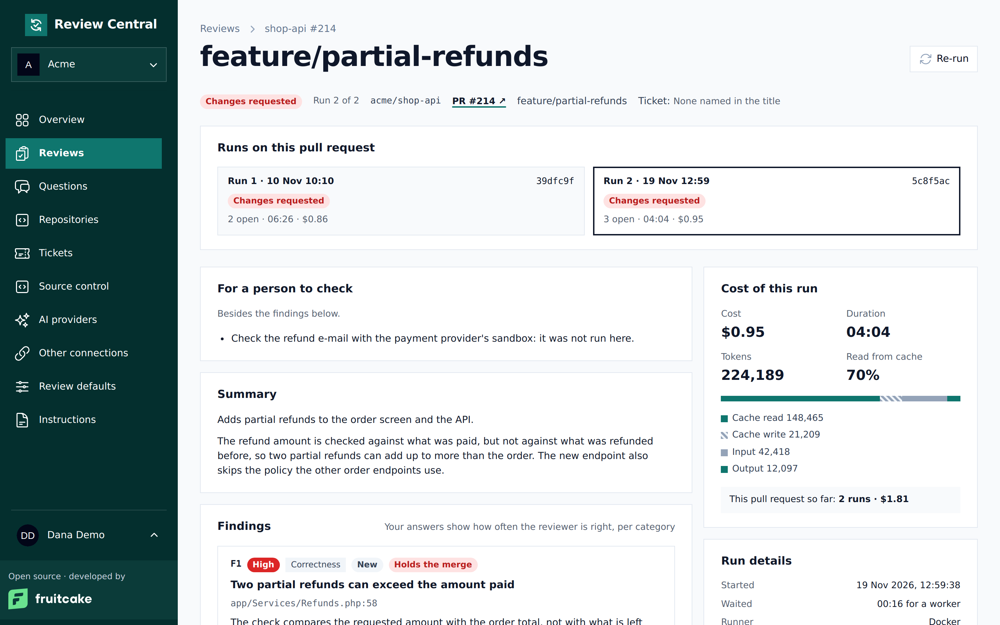
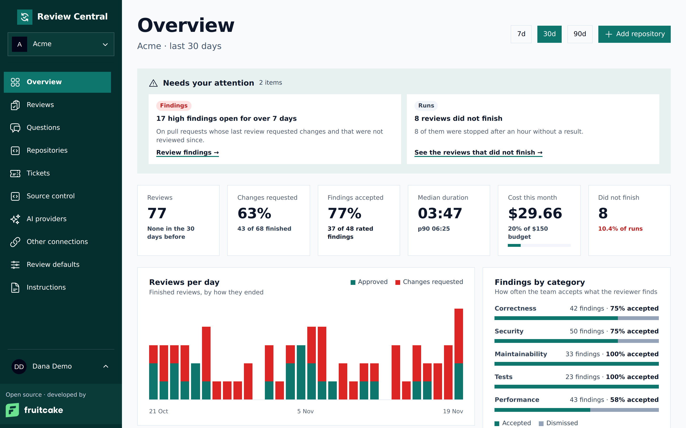
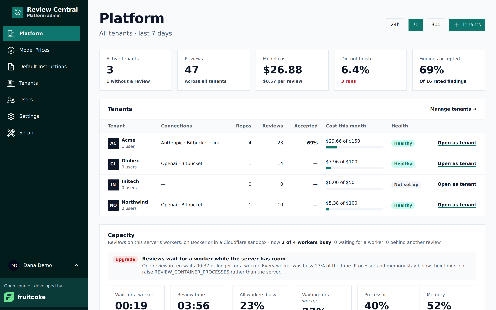
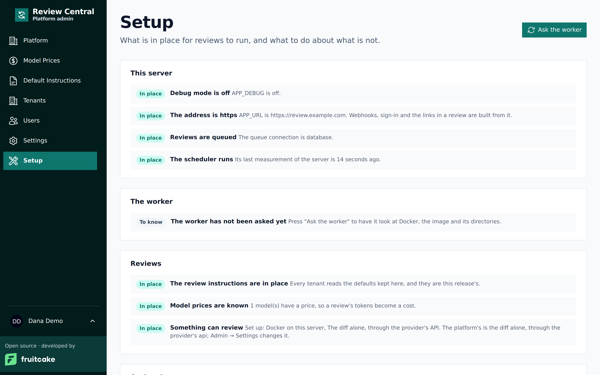

<p align="center"></p>

<h1 align="center">Review Central</h1>

<p align="center">
AI code review you run yourself: every pull request reviewed against its ticket,<br>
by the reviewer and model you choose, on your own server and with your own AI keys.
</p>

<p align="center">
<a href="https://review-central.com"><strong>Documentation</strong></a> ·
<a href="https://review-central.com/guide/quick-start">Quick start</a> ·
<a href="https://review-central.com/guide/installation">Installation</a>
</p>



## What it does

- **Reviews against the ticket.** The reviewer reads the pull request with its ticket from Jira, Asana or GitHub Issues, so it checks what was asked for, not only what was written.
- **Posts on the pull request.** A summary in the description, a comment per finding, tasks for what blocks the merge, and an approval or a request for changes. The next push marks what was fixed. Reviews are posted on Bitbucket; GitHub pull requests can be tried without posting.
- **Your reviewer, your model.** Claude Code, Codex, OpenCodeReview or Pi, with the model and effort you set, or only the diff sent to your AI provider.
- **Sandboxed.** The reviewer reads the code in a throwaway container under gVisor or in a Cloudflare sandbox, holding nothing but the AI key.
- **Many teams, one installation.** Each tenant brings its own connections, colours, currency and time zone; the admin panel shows every tenant's cost against its budget.
- **Measured.** Findings are marked valid, not a problem or wrong, and the overview shows how often the team agrees with the reviewer.

| | |
|---|---|
|  |  |
|  |  |

## Try it in ten minutes

Review a public GitHub pull request from its diff, on your own machine. Nothing is cloned and no code is run. You need PHP 8.3+, Composer, Node and an Anthropic or OpenAI key.

```sh
git clone https://github.com/fruitcake/review-central.git && cd review-central
composer setup               # .env, an app key, SQLite, the tables, the front end
php artisan review:install   # the review's instructions, model prices, your admin account and a first tenant
php artisan serve
```

In a second terminal, run the queue the reviews run on:

```sh
php artisan queue:work --queue=reviews,default
```

Then open http://127.0.0.1:8000, sign in, add your key under **AI providers**, and paste a pull request's address under **Reviews → Try without posting**.

The [quick start](https://review-central.com/guide/quick-start) goes on from there. [Installation](https://review-central.com/guide/installation) sets up a server that reviews every pull request.

To look around without a key, seed a made-up team with a month of reviews, and sign in as `demo@example.com` with the password `password`:

```sh
php artisan migrate:fresh --seed --seeder=DemoSeeder
```

## Documentation

Everything else is on **[review-central.com](https://review-central.com)**:

- [Where a review runs](https://review-central.com/guide/runners): the diff runner, Docker with gVisor, and Cloudflare sandboxes.
- [Setting up a tenant](https://review-central.com/guide/tenants): source control, tickets, AI providers and webhooks.
- [Reviews, settings and cost](https://review-central.com/guide/reviews).
- [Updating](https://review-central.com/guide/updating).
- [Extending](https://review-central.com/guide/extending): adding a provider, a runner or a stack guide.

The docs are in [`docs/`](docs), built with VitePress.

## Contributing and security

Contributions are welcome: see [CONTRIBUTING.md](CONTRIBUTING.md). Report a security problem privately, as [SECURITY.md](SECURITY.md) describes, not in a public issue.

## License

Review Central is open-source software licensed under the [MIT License](LICENSE). It is developed by [Fruitcake](https://fruitcake.nl).
